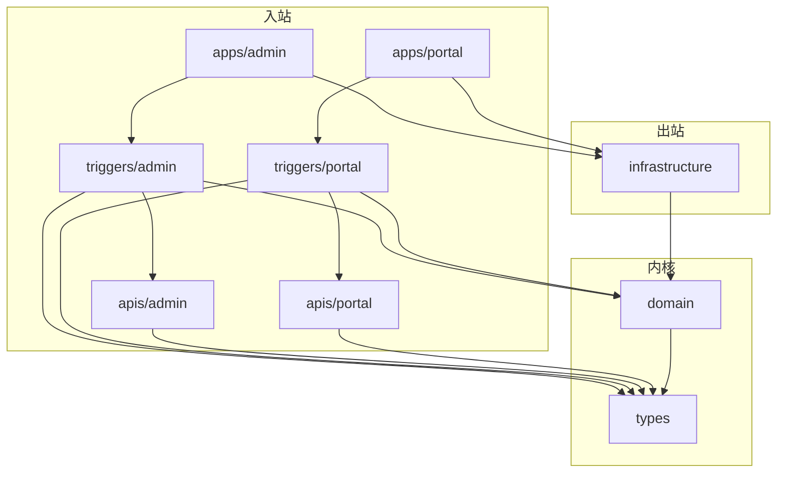
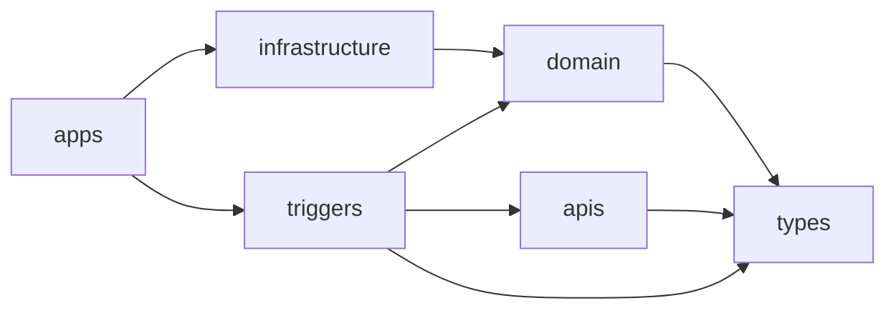
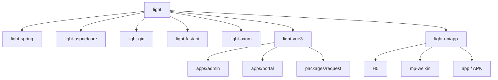
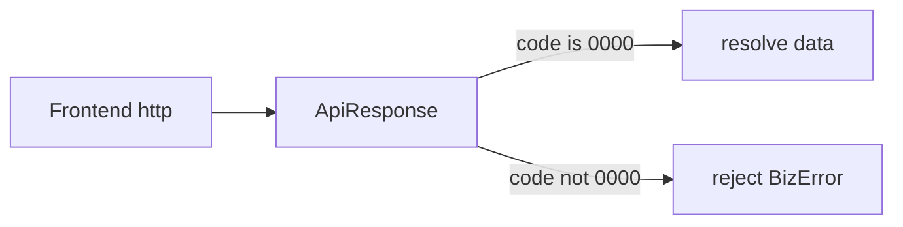
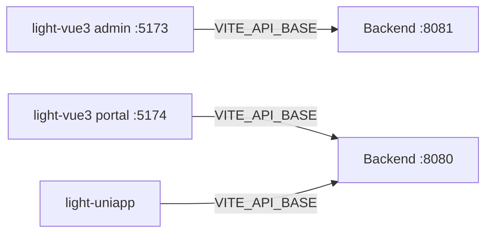

<div align="center">

# Light

**多实现 DDD + 六边形脚手架系列**

Spring · ASP.NET · Gin · FastAPI · Axum · Vue3 · uni-app  
Admin / Portal 双端 · 统一响应约定 · 可独立演进

[](light-spring/)
[](light-aspnetcore/)
[](light-gin/)
[](light-fastapi/)
[](light-axum/)
[](light-vue3/)
[](light-uniapp/)
[](./LICENSE)

</div>

> 同一套领域分层与接口约定，按各语言惯用工程形态落地：角色对齐、依赖单向、可按栈单独取用。

---

## 目录

- [特性](#特性)
- [实现一览](#实现一览)
- [架构约定](#架构约定)
- [目录结构](#目录结构)
- [统一应用约定](#统一应用约定)
- [快速开始](#快速开始)
- [前端说明](#前端说明)
- [常用命令](#常用命令)
- [许可证](#许可证)

## 特性

- **DDD + 六边形**：`types` / `domain` / `infrastructure` / `apis` / `triggers` / `apps` 角色清晰，依赖单向
- **Admin / Portal 双入口**：后端可独立部署（默认 `:8081` / `:8080`）；Vue3 对应 `apps/admin` / `apps/portal`
- **跨栈同构约定**：统一响应 `{ code, message, data }`，JSON `snake_case`，数字一律按字符串输出，404 返回 JSON
- **占位骨架**：`domain/template`（或等价命名空间）+ 分层说明 + `Xxx*` 命名示例，复制后改名即可开业务
- **前端请求封装**：Axios 对齐后端成功码 `code === "0000"` 解包 `data`，业务失败抛 `BizError`
- **多端前端**：`light-vue3`（Web）与 `light-uniapp`（H5 / 微信小程序 / App）

## 实现一览

| 目录 | 技术载体 | 工程形态 |
|------|----------|----------|
| [light-spring](light-spring/) | Spring Boot **4.1** · Java **25** | Maven 多模块（仓内 `light-*` 聚合） |
| [light-aspnetcore](light-aspnetcore/) | ASP.NET Core **.NET 10** | Solution + Projects |
| [light-gin](light-gin/) | Go **1.27** · Gin **1.12** | 单 Go module |
| [light-fastapi](light-fastapi/) | FastAPI **0.162** · Python **≥3.12** | 顶层包 |
| [light-axum](light-axum/) | Axum **0.8** | Cargo workspace |
| [light-vue3](light-vue3/) | Vue **3.5** · Vite **8** | pnpm workspace（admin / portal） |
| [light-uniapp](light-uniapp/) | uni-app（H5 / 微信小程序 / App） | Vite + Vue3 |

## 架构约定

| 角色 | Spring | 其他后端栈（目录） |
|------|--------|-------------------|
| 共享内核 | `light-types` | `types`（Python：`types_`） |
| 领域 | `light-domain` | `domain` |
| 出站适配器 | `light-infrastructure` | `infrastructure` |
| 入站契约 | `light-apis/*` | `apis/admin` · `apis/portal` |
| 入站适配器 | `light-triggers/*` | `triggers/admin` · `triggers/portal` |
| 组装启动 | `light-apps/*` | `apps/admin` · `apps/portal` |

### 六边形视角



### 模块依赖（单向）



禁止：`domain` 依赖 Web/DB 框架；`apis` 依赖 `domain` 实现细节。

## 目录结构



## 统一应用约定

| 项 | 约定 |
|----|------|
| 响应体 | `{ code, message, data }` |
| 业务码 | **四位数字字符串**（见下表） |
| JSON | 字段 `snake_case`；数字一律按字符串写出 |
| 错误页 | 404 / 业务异常统一 JSON，避免框架默认 HTML 页 |
| 端口 | Admin `:8081`，Portal `:8080` |
| 前端 | `code === "0000"` → 返回 `data`；否则 `BizError` |

| code | 含义 |
|------|------|
| `0000` | 成功 |
| `0001` | 未知失败 |
| `0400` | 非法参数 |
| `0404` | 资源不存在 |
| `0405` | 请求方法不支持 |

### 请求解包



## 快速开始

按需进入对应目录即可，不必一次装齐全部栈。

### 后端（Admin 示例）

```bash
# Spring
cd light-spring && mvn -DskipTests install
mvn -pl light-apps/light-admin-app spring-boot:run

# ASP.NET Core
cd light-aspnetcore && dotnet run --project src/apps/admin

# Gin
cd light-gin && go run ./apps/admin

# FastAPI
cd light-fastapi && python -m venv .venv && .venv/bin/pip install -e .
.venv/bin/uvicorn apps.admin.main:app --port 8081

# Axum
cd light-axum && cargo run -p apps_admin
```

### 前端

```bash
# Vue3 管理端（默认请求 http://127.0.0.1:8081）
cd light-vue3 && pnpm install && pnpm dev:admin

# Vue3 Portal（默认请求 http://127.0.0.1:8080）
pnpm dev:portal

# uni-app H5
cd light-uniapp && pnpm install && pnpm dev:h5
```

更多细节见各子目录 README（含微信小程序、App/APK 打包说明）。

## 前端说明

- **light-vue3**：单文件 `tsconfig.json`；Pinia；Tailwind CSS v4；ESLint Flat + Prettier；共享包 `@light/request`
- **light-uniapp**：H5 / `mp-weixin` / `app`；Pinia；Tailwind + `weapp-tailwindcss`；Axios + 非 H5 的 `uni.request` 适配器
- Store 约定：`src/stores` + Composition API（`defineStore(() => {})`），首页 `/health` 示例已迁入 Store
- 环境变量：`VITE_API_BASE`（vue3 两端与 uni 各有 `.env.development`）



## 常用命令

| 栈 | 开发 | 构建 |
|----|------|------|
| light-vue3 | `pnpm dev:admin` / `pnpm dev:portal` | `pnpm build` |
| light-uniapp | `pnpm dev:h5` / `dev:mp-weixin` / `dev:app` | `pnpm build:h5` 等 |
| light-axum | `cargo run -p apps_admin` | `cargo build` |
| light-gin | `go run ./apps/admin` | `go build ./...` |

健康检查路径：`GET /health`（脚手架示例）。

## 许可证

[MIT](./LICENSE) © jiangbyte
