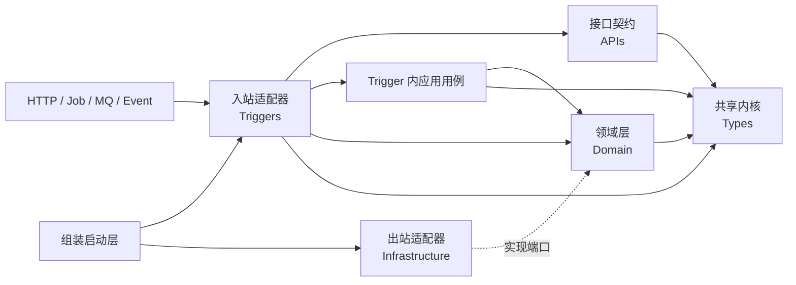

# DDD 与六边形架构开发规范

## 1. 文档目的

本文用于指导项目在 DDD 与六边形架构下进行业务开发，重点回答三个问题：

1. 一个需求应该从哪一层开始设计。
2. 各类代码应该放在哪个模块、哪个目录。
3. 模块之间应该保持怎样的依赖关系。

DDD 主要解决业务边界、领域模型和统一语言问题；六边形架构主要解决内外依赖方向和适配器隔离问题。两者结合后，核心业务不应该被 Controller、数据库、缓存、消息队列或第三方 SDK 绑架。

本文遵循以下原则：

- 依赖方向始终指向领域核心。
- 业务规则优先放在领域模型中，不写在 Controller 或 DAO 中。
- 所有外部访问通过端口或仓储接口隔离。
- 入站协议和出站技术实现都属于可替换适配器。
- 应用组装只负责装配，不承载业务逻辑。

## 2. 总体架构



六边形架构中的“内”和“外”可以这样理解：

```text
               入站侧                         核心                        出站侧

HTTP / Job / MQ  --->  Trigger  --->  Application / Domain  <---  Infrastructure
                                      ^          |
                                      |          |
                                     APIs       Ports
```

- 左侧是用户主动发起请求的入站适配器。
- 中心是业务用例和领域模型。
- 右侧是数据库、Redis、RPC、消息队列、对象存储、模型服务等出站适配器。
- 核心定义接口，外部实现接口。
- 核心不知道外部实现，也不应该导入外部实现所在模块。

## 3. 模块职责

当前项目采用 Maven 多模块组织，主要包含以下角色。

| 模块 | 架构角色 | 主要职责 | 禁止内容 |
|---|---|---|---|
| `light-types` | 共享内核 | 响应码、业务异常、通用响应、基础枚举、事件基类、无业务语义的工具 | 领域实体、Controller、DAO、Repository、Web 和数据库依赖 |
| `light-domain` | 领域核心 | 聚合、实体、值对象、领域服务、领域事件、仓储接口、外部端口 | Controller、DAO、PO、DTO、第三方客户端实现 |
| `light-apis` | 入站契约 | Admin/Portal 对外接口、请求 DTO、响应 DTO、分页模型 | 领域实现、SQL、持久化对象、第三方 SDK |
| `light-triggers` | 入站适配器 | HTTP Controller、定时任务、消息监听、协议转换、应用服务编排 | 核心业务规则、MyBatis 查询、外部客户端实现 |
| `light-infrastructure` | 出站适配器 | Repository 实现、Port 实现、MyBatis DAO、PO、Mapper、Redis、RPC、第三方网关 | Controller、API 响应模型、领域规则 |
| `light-app-common` | 应用基础层 | 全局异常、统一响应、JSON、Web 约束、应用级认证装配、启动公共能力 | 业务实体、业务规则、任何端侧 Trigger 依赖 |
| `light-apps/*` | 组装启动层 | `Application`、Bean 装配、配置、数据源、缓存、线程池、运行环境配置 | 业务逻辑、Controller、DAO 实现主体 |

### 3.1 模块依赖方向

允许的主要依赖：

```text
light-domain          -> light-types
light-infrastructure  -> light-domain
light-apis            -> light-types
light-triggers        -> light-apis
light-triggers        -> light-domain
light-triggers        -> light-types
light-app-common      -> light-infrastructure
light-app-common      -> light-types
light-apps/*          -> light-app-common
light-apps/*          -> 对应 trigger
light-apps/*          -> light-infrastructure
```

需要特别区分编译依赖与运行时调用：

- `light-infrastructure -> light-domain` 表示基础设施实现领域接口。
- 运行时由应用服务或领域服务通过接口调用实现。
- 领域层不能反过来依赖基础设施。
- Admin 和 Portal 可以共享领域与基础设施，但不能通过公共层互相依赖。
- `light-app-common` 不应依赖 `light-trigger-admin` 或 `light-trigger-portal`。

## 4. 分层设计

### 4.1 共享内核层

共享内核只放跨业务域且稳定的基础契约。

适合放置：

- 全局响应码。
- 业务异常。
- 通用响应模型。
- 与具体业务无关的枚举。
- 领域事件和集成事件的基类。
- 基础工具。

不适合放置：

- 某个业务域独有的状态枚举。
- 订单、账户、优惠券等业务实体。
- Repository、DAO、Controller。
- 数据库、Redis、HTTP 客户端。
- Spring Web 和 MyBatis 的强依赖代码。

判断标准：如果删除某个业务域后，代码仍然有存在意义，才适合放在共享内核。

### 4.2 领域层

领域层是整个系统的核心，负责表达业务概念和业务不变量。

领域层的核心内容：

- Aggregate：聚合和聚合根。
- Entity：有身份、有生命周期的实体。
- Value Object：通过属性值表达含义的对象。
- Domain Service：涉及多个对象或聚合的领域规则。
- Domain Event：领域内已经发生的业务事实。
- Repository：聚合状态持久化接口。
- Port：数据库之外的外部能力接口。

领域层应该包含：

- 状态流转规则。
- 唯一性之外的业务约束。
- 金额、数量、时间窗口等规则。
- 聚合内部一致性。
- 业务失败条件和错误语义。

领域层不应该包含：

- Spring MVC、MyBatis、Redis、Feign 等框架实现。
- DAO 查询和 PO 映射。
- API Request DTO 和 Response DTO。
- Controller、定时任务、MQ 监听器。
- 第三方 SDK 的响应对象直接泄露到领域接口。

如果领域需要调用外部能力，应在领域层定义端口，由基础设施层实现：

```java
public interface IPaymentPort {
    PaymentResult pay(PaymentCommand command);
}
```

而不是在领域服务中直接注入支付 SDK。

### 4.3 应用服务层

应用服务表达一个完整用例，负责编排，不负责定义核心业务规则。

应用服务适合处理：

- 多个聚合之间的流程编排。
- 一个用例需要调用多个领域服务或外部端口。
- 事务边界。
- 登录用户、权限和租户上下文。
- 幂等控制。
- 审计记录。
- DTO 到领域输入的转换。
- 领域结果到 API 输出的转换。

应用服务不应该承载：

- 状态机核心规则。
- 聚合一致性规则。
- SQL。
- 第三方协议解析细节。

当前项目暂不设置独立应用模块。应用服务按端放在 Trigger 的业务包中：

```text
light-trigger-admin/
└── trigger/admin/<domain>/<subdomain>/application/    # Admin 用例、Command 和应用级规则

light-trigger-portal/
└── trigger/portal/<domain>/<subdomain>/application/   # Portal 用例和应用级规则
```

应用服务与 HTTP Controller 必须分开：Controller 只做协议处理，应用服务负责用例编排。
未来出现跨端复用或多个入站适配器共享用例时，再评估抽取独立应用模块。

无论物理模块如何变化，逻辑边界都应保持：

```text
Controller -> Application Service -> Domain / Ports
```

### 4.4 入站适配器层

入站适配器负责把外部协议转换成应用内部调用。

包括：

- HTTP Controller。
- 定时任务。
- MQ Consumer。
- Spring Event Listener。
- Webhook 接收器。
- CLI 或批处理入口。

入站适配器的职责：

- 解析协议参数。
- 执行基础格式校验。
- 将 API DTO 转换为领域命令或应用服务输入。
- 调用应用服务或领域服务。
- 将领域结果转换为 API DTO。
- 处理 HTTP 状态、响应头和协议错误。

入站适配器不应该：

- 直接操作 DAO。
- 直接调用第三方 HTTP/RPC 客户端。
- 在 Controller 中编写状态流转。
- 在 Controller 中直接组装数据库 PO。

### 4.5 出站适配器层

出站适配器负责实现领域层定义的接口。

主要包括：

- Repository 实现。
- Port 实现。
- MyBatis DAO 和 Mapper。
- PO 持久化对象。
- Redis 适配器。
- RPC/HTTP 客户端。
- 消息发送适配器。
- 对象存储适配器。

出站适配器的职责：

- 将领域对象转换为 PO 或第三方请求。
- 发起数据库、缓存、RPC、消息调用。
- 将 PO 或第三方响应转换为领域对象。
- 隐藏技术细节和第三方模型。

出站适配器不应该：

- 修改业务状态规则。
- 直接返回第三方 SDK 对象给领域层。
- 依赖 Controller 或 API 响应对象。
- 越过多层直接调用另一个业务域的 Adapter 实现。

### 4.6 组装启动层

应用启动层是组合根，负责把各个模块装配成可运行应用。

主要放置：

- `Application` 启动类。
- Spring Bean 配置。
- 数据源和事务配置。
- Redis、消息队列和客户端配置。
- 线程池配置。
- 拦截器注册。
- 应用配置文件。
- Flyway 迁移配置。
- 第三方客户端初始化。

启动层不应放入：

- Controller。
- 业务实体。
- 业务流程。
- SQL 和 Mapper 业务查询。

`light-app-common` 只承载应用基础能力，不承载业务。它可以帮助 Admin 和 Portal 共享统一响应、异常处理和认证装配，但不能成为业务逻辑公共包的替代品。

## 5. 当前项目目录规范

### 5.1 领域目录

业务代码按“业务域 -> 子领域 -> DDD 对象”组织，不在 `domain` 根目录下平铺。

```text
light-domain/src/main/java/io/jiangbyte/github/domain/    # 领域层源码根目录
└── <domain>/                                           # 一个业务域，例如 account、order、coupon
    ├── adapter/                                        # 领域依赖的外部能力接口
    │   ├── port/                                       # 第三方或跨域能力端口
    │   │   └── I<Capability>Port.java                  # 端口接口，由基础设施层实现
    │   └── repository/                                 # 聚合持久化接口
    │       └── I<Aggregate>Repository.java             # 仓储接口，由基础设施层实现
    ├── event/                                          # 领域事件
    │   └── <Business>Event.java                        # 业务事实，例如 OrderPaidEvent
    ├── model/                                          # DDD 领域模型
    │   ├── aggregate/                                  # 聚合与聚合根
    │   │   └── <Business>Aggregate.java                # 聚合根，维护内部一致性
    │   ├── entity/                                     # 有身份和生命周期的实体
    │   │   └── <Business>Entity.java                   # 实体对象
    │   └── valobj/                                     # 值对象
    │       ├── <Business>VO.java                       # 金额、条件、状态值等值对象
    │       └── enums/                                  # 值对象相关枚举
    │           └── <Business>StatusEnum.java           # 状态枚举及其业务含义
    └── service/                                        # 领域服务
        ├── I<Business>Service.java                     # 领域服务接口，可选
        └── <Business>Service.java                      # 跨实体但不跨用例的业务规则
```

示例：

```text
domain/                                                 # 领域层包路径
└── coupon/                                             # 优惠券业务域
    ├── adapter/                                        # 优惠券领域的外部接口
    │   ├── port/                                       # 优惠券需要的外部能力
    │   │   └── ICouponEventPort.java                   # 发布优惠券事件，由基础设施实现
    │   └── repository/                                 # 优惠券聚合持久化接口
    │       └── ICouponRepository.java                  # 查询、保存优惠券聚合
    ├── event/                                          # 优惠券领域事件
    │   └── CouponReceivedEvent.java                    # 用户领取优惠券成功事件
    ├── model/                                          # 优惠券领域模型
    │   ├── aggregate/                                  # 优惠券聚合
    │   │   └── CouponAggregate.java                    # 维护领取、使用和失效规则
    │   ├── entity/                                     # 优惠券实体
    │   │   └── CouponEntity.java                       # 包含优惠券身份和生命周期
    │   └── valobj/                                     # 优惠券值对象
    │       └── CouponStatusVO.java                     # 未领取、已领取、已使用、已过期
    └── service/                                        # 优惠券领域服务
        ├── ICouponDomainService.java                   # 领域服务接口，可选
        └── CouponDomainService.java                    # 跨实体的优惠券业务规则
```

注意：不同业务域不要共用领域实体。跨域协作通过应用服务、领域事件、端口或明确的共享值对象完成。

### 5.2 API 目录

Admin 和 Portal 的接口契约分别放在自己的 API 模块中。

```text
light-api-admin/src/main/java/io/jiangbyte/github/api/admin/ # Admin API 契约源码根目录
└── <domain>/                                           # 一个业务域，例如 account、order、coupon
    ├── I<Business>Service.java                         # 对外接口契约，由 Controller 实现
    └── dto/                                            # 该业务域的 API 传输模型
        ├── <Business>RequestDTO.java                   # 新增或修改请求
        ├── <Business>ResponseDTO.java                  # 对外响应数据
        └── <Business>QueryDTO.java                     # 查询参数对象
```

Portal 使用相同结构，但放在 `api/portal` 下。

分页接口统一命名为 `/page`，只使用 `/page` 承载 `page`、`pageSize` 等分页参数。
`/list` 仅用于不分页列表，不作为分页接口的兼容别名。

API DTO 只表达协议契约，不放以下内容：

- 数据库字段语义。
- MyBatis 注解。
- 第三方 SDK 对象。
- 继承领域实体。
- Controller 实现代码。

多个业务重复使用的纯结构参数放入 `light-types`，例如：

- `PageResult<T>`：通用分页结果。
- `PageConstants`：默认页码、默认每页数量和每页数量上限。
- `IdRequestDTO`：通用单个 ID 请求，包含非空和正整数校验。
- `IdsRequestDTO`：通用批量 ID 请求，包含空集合、数量和正整数校验。

业务专属字段不要为了复用强行塞进通用 DTO。

### 5.3 Trigger 目录

Trigger 按业务域、子领域和技术入口组织。

```text
light-trigger-admin/                                    # Admin 入站适配器模块
src/main/java/io/jiangbyte/github/trigger/admin/        # Admin 入站适配器源码根目录
└── <domain>/                                           # 一个业务域
    └── <subdomain>/                                    # 业务域内的子模块
        ├── application/                                # 仅限留在 Trigger 的轻量应用服务
        │   ├── I<Business>ApplicationService.java      # 应用服务接口，可选
        │   └── <Business>ApplicationService.java       # 当前端应用用例与编排
        └── http/                                       # HTTP 入站适配器
            └── <Business>Controller.java               # 协议转换并调用应用服务
```

其他入口按同样方式扩展：

```text
<domain>/                                               # 一个业务域
└── <subdomain>/                                        # 业务域内的子模块
    ├── job/                                            # 定时任务入口
    │   └── <Business>Job.java                          # 调度任务，调用应用服务
    ├── listener/                                       # 事件或消息入口
    │   └── <Business>Listener.java                     # 消费事件并调用应用服务
    └── http/                                           # HTTP 入口
        └── <Business>Controller.java                   # 实现 API 契约的 Controller
```

Controller 只负责：

1. 接收请求。
2. 执行语法校验。
3. 转换为命令或应用服务参数。
4. 调用应用服务。
5. 转换响应。

### 5.4 Infrastructure 目录

Infrastructure 按业务域组织 Repository、Port、DAO 和外部网关。

```text
light-infrastructure/src/main/java/io/jiangbyte/github/infrastructure/ # 出站适配器源码根目录
└── <domain>/                                           # 一个业务域
    ├── persistence/                                    # 聚合持久化适配器
    │   ├── <Business>Repository.java                   # 实现领域层 Repository 接口
    │   ├── dao/                                        # 数据库访问接口
    │   │   └── I<Business>Dao.java                     # MyBatis DAO
    │   └── po/                                         # 数据库持久化模型
    │       └── <Business>PO.java                       # 与数据库表对应的 PO
    ├── gateway/                                        # RPC、HTTP 等外部服务适配器
    │   ├── <Business>Gateway.java                      # 外部客户端封装
    │   └── dto/                                        # 第三方服务的数据模型
    │       └── <Business>RemoteDTO.java                # RPC/HTTP 响应 DTO
    └── redis/                                          # 缓存适配器
        └── <Business>CacheAdapter.java                 # 实现缓存端口或辅助 Repository
```

如果某个业务域的数据库和外部调用都很简单，可以在业务域内部保持较小结构，但不要把所有领域混在一个 `adapter` 根目录中。

Repository 和 Port 的区别：

- Repository 表达聚合的持久化集合，通常对应数据库。
- Port 表达领域需要的外部能力，可能对应 RPC、HTTP、消息、缓存或其他系统。

### 5.5 App 目录

```text
light-apps/                                             # 应用组装与可部署模块目录
├── light-app-common/                                   # Admin 与 Portal 共享的应用基础能力
│   └── src/main/java/io/jiangbyte/github/              # 公共应用能力源码目录
│       ├── config/                                     # 全局异常、响应、Web 和启动配置
│       └── account/                                    # 应用级认证装配，不放业务规则
├── light-admin-app/                                    # 管理端可部署应用
│   └── src/main/                                       # Admin 模块源码与资源根目录
│       ├── java/io/jiangbyte/github/                   # Admin Java 源码目录
│       │   ├── AdminApplication.java                   # 管理端启动入口
│       │   ├── config/                                 # Admin 专属 Web 和基础设施配置
│       │   └── account/                                # Admin 专属认证装配与初始化
│       └── resources/                                  # Admin 环境配置、迁移脚本和静态资源
└── light-portal-app/                                   # Portal 可部署应用
    └── src/main/                                       # Portal 模块源码与资源根目录
        ├── java/io/jiangbyte/github/                   # Portal Java 源码目录
        │   ├── PortalApplication.java                  # Portal 启动入口
        │   ├── config/                                 # Portal 专属 Web 和基础设施配置
        │   └── account/                                # Portal 专属认证装配
        └── resources/                                  # Portal 环境配置、迁移脚本和静态资源
```

端侧应用只保留：

- 自己的启动类。
- 自己的配置前缀。
- 自己的认证装配。
- 自己的环境配置。
- 自己独有的初始化逻辑。

公共基础能力放入 `light-app-common`，但不能把 Admin 或 Portal 的业务编排放入公共层。

## 6. DDD 模型开发规则

### 6.1 Entity

实体有唯一标识和生命周期。

实体适合放置：

- 自身状态变化。
- 不依赖外部服务的业务判断。
- 自身数据完整性规则。

实体不适合：

- 注入 Repository。
- 注入 Application Service。
- 直接发送消息。
- 直接调用 HTTP 或数据库。

### 6.2 Value Object

值对象通过属性值表达业务含义，例如：

- 金额。
- 时间范围。
- 手机号。
- 订单状态。
- 优惠券使用条件。

值对象优先设计为不可变对象，并在构造时校验合法性。不要把大量无行为枚举和字符串继续散落在实体中。

### 6.3 Aggregate

聚合是事务和一致性边界。

聚合设计规则：

- 每个聚合有明确聚合根。
- 外部只通过聚合根访问聚合内部对象。
- 在一次事务内只修改一个聚合。
- 跨聚合一致性通过领域事件、最终一致性或应用服务编排实现。
- 一个聚合通常对应一个 Repository。
- 聚合不要过大，避免一次修改锁定大量无关数据。

### 6.4 Domain Service

领域服务用于放置无法自然归属到单个实体的领域规则。

适合：

- 多个实体之间计算价格。
- 根据账户状态和业务规则判断是否允许操作。
- 使用领域端口完成必要的业务能力组合。

不适合：

- 单纯转发 Repository。
- Controller 的直接代理。
- 事务脚本。
- 为了“分层好看”而创建的薄包装类。

### 6.5 Application Service

应用服务围绕用户用例命名，例如：

- `CreateOrderApplicationService`
- `ChangePasswordApplicationService`
- `PublishArticleApplicationService`

应用服务负责流程，不负责定义聚合内部规则。

典型流程：

```text
1. 校验应用级输入
2. 获取当前用户和权限上下文
3. 加载所需聚合
4. 调用领域行为
5. 保存聚合
6. 发布事件或调用外部端口
7. 返回用例结果
```

### 6.6 Repository

Repository 的接口属于领域层，实现属于基础设施层。

接口示例：

```java
public interface IOrderRepository {
    OrderEntity findById(long id);

    void save(OrderAggregate aggregate);
}
```

Repository 实现负责：

- 调用 DAO。
- PO 和领域对象互转。
- 处理数据库异常到业务异常的转换。
- 必要时处理缓存。

Repository 实现不应返回 PO，也不应要求领域层理解数据库字段。

### 6.7 Port

Port 用于领域需要但不由当前系统实现的能力。

适合：

- 支付。
- 短信。
- 对象存储。
- 第三方用户中心。
- LLM 或向量检索。
- 消息发布。

端口定义在领域侧，具体 SDK 对象在适配器中转换为项目自己的领域对象。

### 6.8 Event

领域事件表达业务事实，例如：

- `OrderPaidEvent`
- `AccountDisabledEvent`
- `CouponReceivedEvent`

事件名称使用过去时，事件中只放下游需要的最小信息。

领域事件不应直接依赖某个 MQ SDK。发布动作可以通过端口或应用服务完成。

## 7. 数据模型转换边界

系统至少包含以下模型：

| 模型 | 所属位置 | 用途 |
|---|---|---|
| Request DTO | API | 接收外部请求 |
| Response DTO | API | 返回外部响应 |
| Command | Application/Domain | 表达一个业务操作意图 |
| Query | Application/Domain | 表达查询条件 |
| Entity/Aggregate/VO | Domain | 表达业务模型和业务规则 |
| PO | Infrastructure | 表达数据库记录 |
| Remote DTO | Infrastructure | 表达第三方接口数据 |

转换方向：

```text
Request DTO
    -> Command / Domain Input
    -> Domain Entity / Aggregate
    -> PO
    -> Database

Database
    -> PO
    -> Domain Entity / Aggregate
    -> Response DTO
```

禁止跨边界直接复用对象：

- Controller 不能直接接收 PO。
- Domain 不能直接接收 API Request DTO。
- Repository 不能返回第三方 Remote DTO。
- API Response 不能暴露 PO。
- 第三方 SDK 对象不能直接穿透到 API 层。

## 8. 新增业务的标准开发步骤

以新增“优惠券”业务为例。

### 第一步：定义用例和边界

先写清楚：

- 谁发起操作。
- 输入是什么。
- 输出是什么。
- 哪些状态必须满足。
- 哪些外部系统参与。
- 哪些数据需要持久化。
- 失败时返回什么业务错误。

例如：

- 用户领取优惠券。
- 同一用户每个活动只能领取一次。
- 活动过期后不能领取。
- 领取成功后发布事件。

### 第二步：设计 API 契约

在 API 模块增加：

```text
api/admin/coupon/ICouponService.java                   # Admin 优惠券接口契约
api/admin/coupon/dto/CreateCouponRequestDTO.java       # 创建优惠券请求模型
api/admin/coupon/dto/CouponResponseDTO.java            # 优惠券响应模型
```

API 契约只描述对外能力，不包含实现。

### 第三步：设计领域模型

在 domain 增加：

```text
domain/coupon/model/aggregate/CouponAggregate.java     # 优惠券聚合根
domain/coupon/model/entity/CouponEntity.java           # 优惠券实体
domain/coupon/model/valobj/CouponStatusVO.java         # 优惠券状态值对象
domain/coupon/adapter/repository/ICouponRepository.java # 优惠券聚合持久化接口
domain/coupon/adapter/port/ICouponEventPort.java       # 优惠券事件发布端口
domain/coupon/service/CouponDomainService.java         # 优惠券领域服务
```

领域模型负责：

- 是否可领取。
- 状态流转。
- 失效时间判断。
- 聚合内部一致性。

### 第四步：实现应用服务

如果流程包含多个步骤，在当前端的 Trigger 业务包中增加应用服务：

```text
light-triggers/light-trigger-admin/src/main/java/io/jiangbyte/github/trigger/admin/content/coupon/application/CouponApplicationService.java # Admin 优惠券用例
```

应用服务负责：

- 加载用户和优惠券。
- 调用领域服务。
- 保存聚合。
- 发布事件。
- 转换返回结果。

简单单聚合流程可以暂时由领域服务完成，但 Controller 仍然只做协议转换。

### 第五步：实现入站适配器

增加 Controller：

```text
trigger/admin/coupon/http/CouponController.java        # 优惠券 HTTP 入站适配器
```

Controller 实现 API 接口，并调用应用服务。

### 第六步：实现出站适配器

增加：

```text
infrastructure/coupon/persistence/CouponRepository.java # 仓储实现，完成 Entity 与 PO 转换
infrastructure/coupon/persistence/dao/ICouponDao.java   # 优惠券 MyBatis DAO
infrastructure/coupon/persistence/po/CouponPO.java     # 优惠券数据库持久化对象
infrastructure/coupon/gateway/CouponEventPort.java     # 优惠券事件端口实现
```

Repository 负责 PO 和领域对象转换，Port 负责事件系统或外部服务调用。

### 第七步：完成应用装配

通常只需要增加：

- MyBatis Mapper 扫描。
- Bean 配置。
- 外部客户端配置。
- 数据库迁移脚本。

业务代码不应放入 `light-apps`。

### 第八步：补齐测试

至少覆盖：

- 聚合业务规则测试。
- 领域服务测试。
- 应用服务编排测试。
- Repository PO/Entity 转换测试。
- Controller 契约测试。

## 9. 代码落位速查表

| 代码内容 | 放置位置 |
|---|---|
| HTTP Request/Response DTO | `light-apis` 的对应端 API 模块 |
| API 接口 | `light-apis` |
| Controller | `light-triggers/*/.../http` |
| 应用服务 | `light-triggers/*/.../application` |
| 定时任务 | `light-triggers/*/.../job` |
| MQ 或事件监听器 | `light-triggers/*/.../listener` |
| 聚合、实体、值对象 | `light-domain/<domain>/model` |
| 领域规则 | Entity、Aggregate、Value Object、Domain Service |
| 仓储接口 | `light-domain/<domain>/adapter/repository` |
| 外部能力端口 | `light-domain/<domain>/adapter/port` |
| 领域事件 | `light-domain/<domain>/event` |
| Repository 实现 | `light-infrastructure/<domain>/persistence` |
| Port 实现 | `light-infrastructure/<domain>/gateway` 或业务对应目录 |
| MyBatis DAO | `light-infrastructure/<domain>/persistence/dao` |
| 持久化 PO | `light-infrastructure/<domain>/persistence/po` |
| 第三方 DTO | `light-infrastructure/<domain>/gateway/dto` |
| Redis 适配器 | `light-infrastructure/<domain>/redis` |
| 全局错误码和基础异常 | `light-types` |
| 全局 Web 和异常处理 | `light-app-common` |
| 启动类和运行配置 | `light-apps/*` |

## 10. 分层判断方法

当不确定代码该放在哪里时，依次判断：

1. 它是否在表达业务不变量？
   是：放领域模型或领域服务。
2. 它是否在协调多个步骤、聚合或外部端口？
   是：放应用服务。
3. 它是否只负责 HTTP、Job、MQ 等协议转换？
   是：放入站适配器。
4. 它是否在访问数据库、Redis、RPC、文件或第三方 API？
   是：放出站适配器。
5. 它是否定义对外接口和传输数据？
   是：放 API 模块。
6. 它是否是跨业务域的基础错误码或通用模型？
   是：放共享内核。
7. 它是否只是 Spring Bean、客户端、线程池或启动配置？
   是：放应用组装层。

## 11. 常见错误

### 11.1 Controller 变成业务服务

错误表现：

- Controller 中出现复杂 if/else。
- Controller 直接操作 DAO。
- Controller 组装多个 PO。
- Controller 直接处理支付、库存、状态机。

正确做法：

- 参数和响应转换留在 Controller。
- 用例编排进入应用服务。
- 业务规则进入领域模型。

### 11.2 Repository 中写业务规则

错误表现：

- Repository 根据状态决定是否允许操作。
- Repository 内发送业务消息并修改多个聚合。
- DAO 查询结果直接作为 API 返回。

正确做法：

- Repository 只负责存取和转换。
- 业务判断进入领域模型。
- 多步骤流程进入应用服务。

### 11.3 Domain 依赖第三方 SDK

错误表现：

- Domain 接口返回第三方框架对象。
- Domain 直接导入数据库、HTTP、支付 SDK。
- 更换供应商时必须改领域层。

正确做法：

- 在 Domain 定义自己的对象和 Port。
- 第三方对象只在 Infrastructure 中出现。
- Adapter 完成第三方对象到领域对象的转换。

### 11.4 所有对象都放进公共模块

错误表现：

- 任何 DTO、工具、枚举都放 `types`。
- Admin 与 Portal 的接口模型混在一起。
- `app-common` 中开始出现业务代码。

正确做法：

- 只有真正跨业务域稳定的内容才进入公共模块。
- Admin/Portal 契约分别维护。
- 应用公共层只放应用基础设施。

### 11.5 为了分层创建空壳类

错误表现：

- Controller 只调用一个同名 Service。
- Service 只调用一个同名 Repository。
- Application Service 只是纯转发。

正确做法：

- 简单流程允许直接调用领域服务。
- 只有出现真实编排、事务、权限、幂等或多步骤需求时再增加应用服务。
- 分层是为了边界，不是为了强制制造更多类。

## 12. 测试策略

### 12.1 领域层测试

重点测试：

- 聚合创建。
- 状态变化。
- 业务不变量。
- 错误码和异常分支。

领域测试不启动 Spring，不连接数据库，不启动 Web 容器。

### 12.2 应用服务测试

重点测试：

- 多步骤编排顺序。
- 事务边界。
- 领域服务与端口调用。
- 幂等和权限判断。

Repository 和 Port 可以使用 Mock。

### 12.3 入站适配器测试

重点测试：

- URL、HTTP Method。
- 参数绑定。
- DTO 校验。
- 返回码和 JSON 结构。
- 协议层的异常转换。

### 12.4 出站适配器测试

重点测试：

- PO 与 Entity 的双向转换。
- 第三方 DTO 与领域对象的转换。
- 数据库查询条件。
- 外部异常映射。

## 13. 代码评审清单

提交业务代码前检查：

- [ ] Controller 中是否有业务规则？
- [ ] Domain 是否导入了 Controller、DAO、PO 或基础设施实现？
- [ ] Repository 是否只负责持久化和对象转换？
- [ ] 外部 SDK 对象是否泄露到了 Domain 或 API？
- [ ] API DTO 是否直接继承了领域实体？
- [ ] 聚合是否具备明确的一致性边界？
- [ ] 跨聚合流程是否放在应用服务中？
- [ ] 第三方调用是否通过 Port 隔离？
- [ ] 全局公共模块中是否混入了单业务域代码？
- [ ] Admin 与 Portal 是否产生了不必要耦合？
- [ ] 事务边界是否位于应用层？
- [ ] 入站和出站适配器是否都有对应测试？
- [ ] 新增代码是否遵循“业务域 -> 子领域 -> 技术适配”的目录结构？

## 14. 演进原则

架构应随着复杂度演进，而不是一开始制造过多模块。

当前阶段：

- 保持现有七个主模块。
- 账户等既有应用服务暂时保留在 Trigger 的业务包中。
- 内容公告的应用服务放在 Trigger 的 `application` 子包中。
- Domain 按业务域分包。
- Infrastructure 按业务域分包。

复杂度上升后：

- 跨端应用服务形成稳定复用需求后，再评估抽取独立应用模块。
- 业务域边界稳定但团队规模扩大时，按业务域拆分子模块。
- 查询复杂且读写差异明显时，再考虑 CQRS。
- 跨域异步协作增多时，引入正式领域事件和消息契约。
- 第三方依赖过多时，强化 Port 和 Anti-Corruption Layer。

无论采用哪种演进方式，都应保持以下底线：

1. 依赖方向指向领域核心。
2. 业务规则不进入 Controller 和 DAO。
3. 外部技术实现可替换。
4. Admin 与 Portal 保持独立部署边界。
5. 共享层只承载真正稳定的公共能力。
